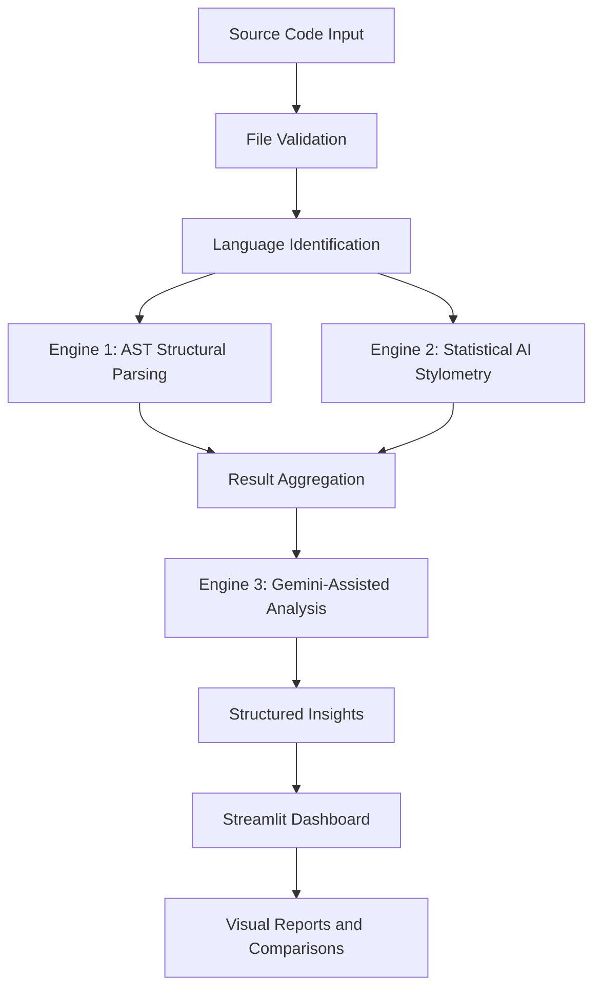

# Code Integrity Auditor

### An Intelligent Multi-Layer Source Code Analysis & Integrity Assessment Platform

**Analyze. Compare. Detect. Understand Code Integrity.**

Code Integrity Auditor (CIA) is an academic software-engineering project that explores source-code analysis through three complementary layers: AST structural parsing, statistical AI stylometry, and LLM-assisted interpretation. The initial implementation is being developed in Python with a Streamlit dashboard and the Gemini API.

> **Development status:** Day 1 — project foundation. The analysis engines are planned modules and are not represented as completed features yet.

---

## Project objectives

- Inspect source-code structure using Abstract Syntax Trees.
- Measure selected code characteristics using statistical and stylometric features.
- Add Gemini-assisted contextual explanations to analytical results.
- Establish a path toward Python, C++, and Java parsing.
- Present results through an interactive Streamlit dashboard.
- Validate components with automated tests and curated evaluation datasets.

## Planned analytical architecture



### Planned engines

| Engine | Responsibility | Planned technologies |
|---|---|---|
| AST Structural Parsing | Syntax trees, node traversal, control-flow characteristics, language parsing | Python `ast`, Tree-sitter |
| Statistical AI Stylometry | Entropy, token distributions, formatting and stylometric ratios | NumPy, regular expressions |
| LLM-Assisted Analysis | Contextual explanations and structured feedback | Gemini API, `google-genai` |

The system is intended to support comparative analysis. Its scores must not be treated as definitive proof that code was or was not written by a human or an AI system.

---

## Technology stack

- **Language:** Python
- **Dashboard:** Streamlit
- **LLM provider:** Google Gemini API
- **Official Python SDK:** `google-genai`
- **Parsing:** Python `ast`, Tree-sitter
- **Numerical analysis:** NumPy
- **Visualization:** Plotly
- **Configuration:** python-dotenv
- **Testing:** pytest
- **Version control:** Git and GitHub

## Repository structure

```text
Code-Integrity-Auditor/
├── app.py
├── README.md
├── requirements.txt
├── .gitignore
├── .env.example
├── config/
│   ├── __init__.py
│   └── settings.py
├── engines/
├── parsers/
├── analysis/
├── services/
│   └── gemini_service.py
├── dashboard/
├── utils/
├── tests/
│   ├── test_app.py
│   └── test_gemini_service.py
├── datasets/
│   └── README.md
└── docs/
    └── README.md
```

The `engines`, `parsers`, `analysis`, `dashboard`, and `utils` packages are scaffolding for upcoming development days.

---

## Getting started

### 1. Prerequisites

- Python 3.10 or newer
- Git
- A Google Gemini API key from [Google AI Studio](https://aistudio.google.com/app/apikey)

### 2. Clone the repository

```bash
git clone https://github.com/YOUR-USERNAME/Code-Integrity-Auditor.git
cd Code-Integrity-Auditor
```

### 3. Create and activate a virtual environment

**Windows PowerShell:**

```powershell
python -m venv .venv
.\.venv\Scripts\Activate.ps1
```

**Windows Command Prompt:**

```bat
python -m venv .venv
.venv\Scripts\activate.bat
```

**Linux / macOS:**

```bash
python3 -m venv .venv
source .venv/bin/activate
```

### 4. Install dependencies

```bash
python -m pip install --upgrade pip
pip install -r requirements.txt
```

### 5. Configure Gemini API

Copy `.env.example` to `.env` in the project root.

**Windows PowerShell:**

```powershell
Copy-Item .env.example .env
```

**Windows Command Prompt:**

```bat
copy .env.example .env
```

**Linux / macOS:**

```bash
cp .env.example .env
```

Open `.env` and replace the placeholder with your own key:

```env
GEMINI_API_KEY=your_actual_gemini_api_key
GEMINI_MODEL=gemini-3.8-flash
```

Keep `.env` private. It is excluded by `.gitignore`. Do not paste API keys into source files, screenshots, commits, or public issue reports.

### 6. Run the application

```bash
streamlit run app.py
```

The Day 1 dashboard should open in your browser. It can start without an API key; the Gemini connection test becomes available after `.env` is configured.

### 7. Test Gemini connection

In the dashboard, select **Test Gemini API connection**. This sends a short test prompt to the configured Gemini model. A successful response confirms that the local key, SDK, model selection, and API access are working together.

### 8. Run automated tests

```bash
pytest -q
```

The unit tests mock Gemini client construction and do not consume API quota. The dashboard's live connection test is a separate, explicit action.

---

## Day 1 deliverables

- [x] Modular project directory scaffold
- [x] Streamlit application entry point
- [x] Gemini API configuration through `.env`
- [x] Gemini connection-test service
- [x] Dependency manifest
- [x] Git ignore rules and safe environment example
- [x] Basic automated tests
- [ ] Create and push the GitHub repository
- [ ] Verify local Streamlit launch and Gemini connection

## Security and responsible use

- Never commit `.env`, API keys, or private credentials.
- Do not upload confidential source code or personal data to an external LLM.
- Treat uploaded source code and model responses as untrusted input.
- Validate model output before using it in later processing stages.
- Treat all stylometric outputs as indicators, not proof of authorship.
- Document dataset provenance and permissions before distributing datasets.

## Current limitations

This Day 1 version is a foundation only. It does not yet implement AST feature extraction, C++/Java grammar parsing, statistical stylometry, AI-authorship classification, multi-file comparison, or report export. Those capabilities belong to later development stages and should be marked complete only after implementation and testing.

## Contributing

For a team project, use feature branches and pull requests. Keep changes modular, add tests for new behavior, and avoid committing secrets or generated environment files.

```bash
git checkout -b feature/your-feature-name
git add .
git commit -m "feat: describe your change"
git push -u origin feature/your-feature-name
```

## License

No license has been selected yet. Add a `LICENSE` file after the project team decides how the code may be used and redistributed.

---

<p align="center">
  <strong>CODE INTEGRITY AUDITOR</strong><br>
  Engineering Intelligent Approaches to Source Code Analysis.
</p>
